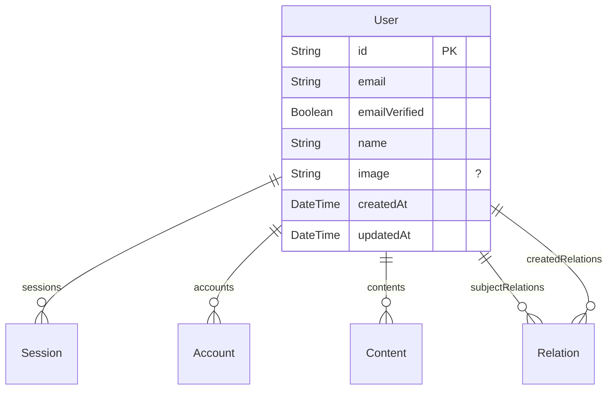
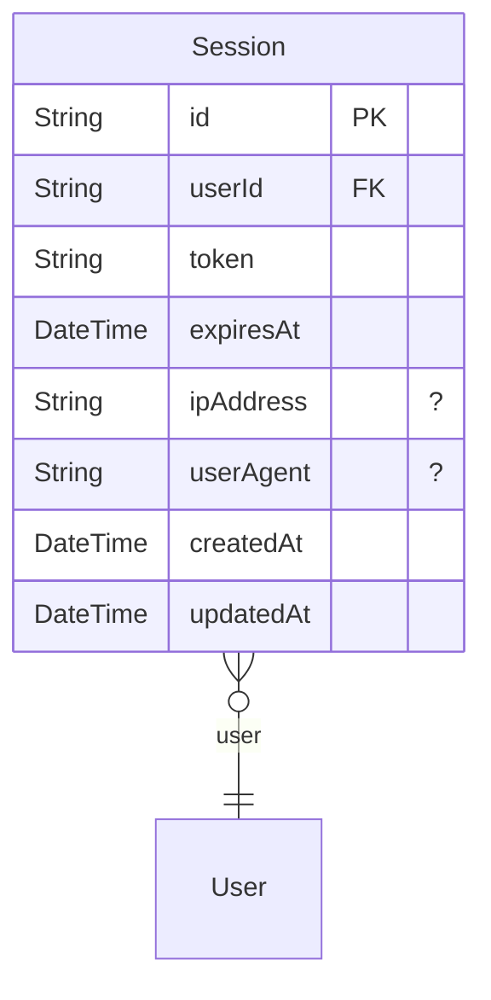
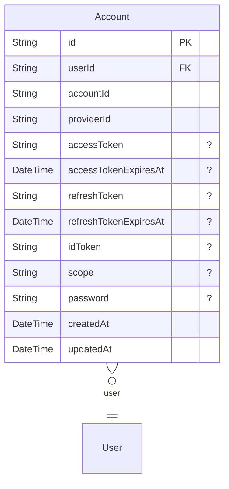
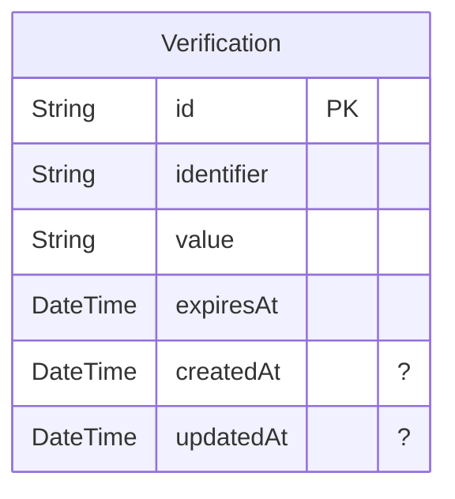
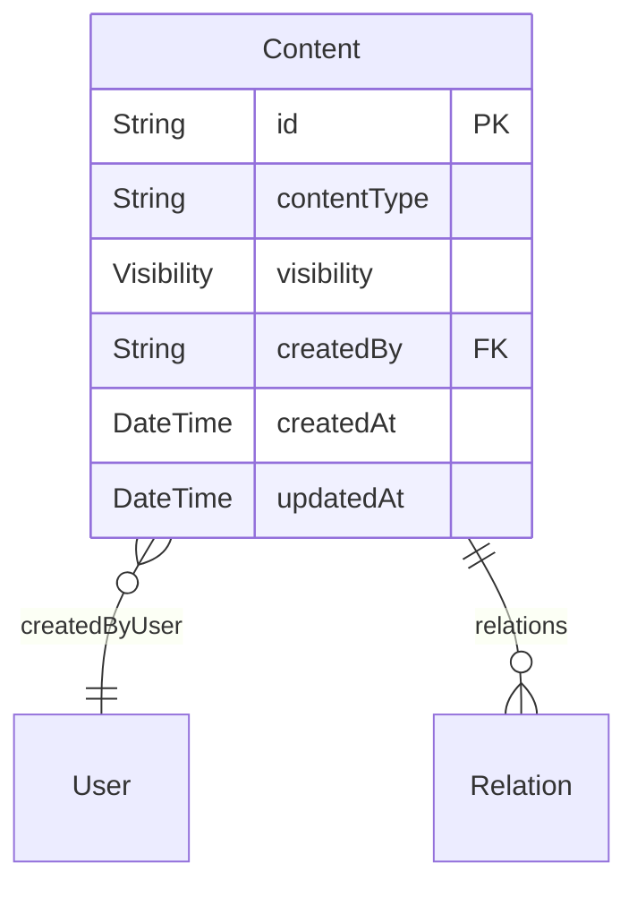
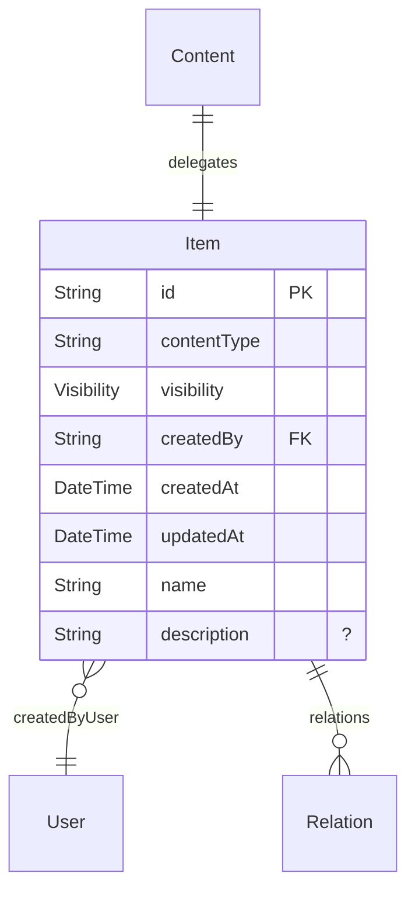
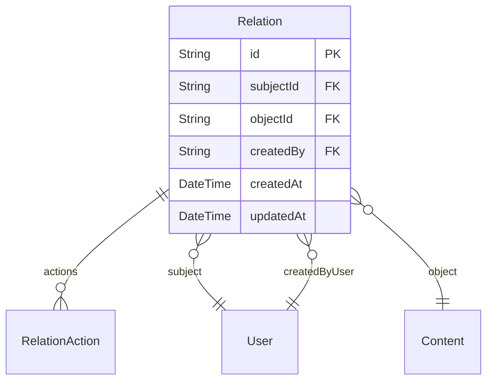
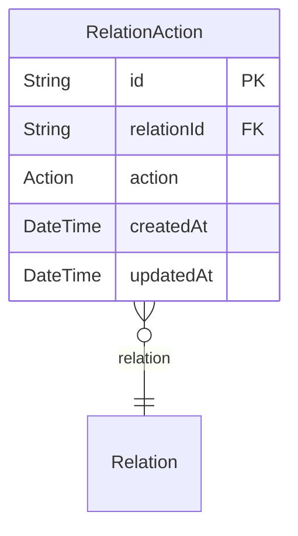

# Technical Design Document

## Overview

This ZModel schema defines a robust content management system with user authentication, flexible content visibility, and a comprehensive role-based access control mechanism. It allows users to create and manage various types of content and control access through relations and specific actions.

## Functionality

-   User registration and authentication
-   Content creation and management
-   Control content visibility (public/private)
-   Establish relations between users and content
-   Granular access control (READ, UPDATE, DELETE, GRANT) on content
-   Management of user sessions and accounts

## Enums

### Visibility

Controls the access level of content, either PUBLIC or PRIVATE.

-   PUBLIC
-   PRIVATE

### Action

Defines the types of operations that can be performed within a relation, including READ, UPDATE, DELETE, and GRANT.

-   READ
-   UPDATE
-   DELETE
-   GRANT

## Models

-   [User](#user)
-   [Session](#session)
-   [Account](#account)
-   [Verification](#verification)
-   [Content](#content)
-   [Item](#item)
-   [Relation](#relation)
-   [RelationAction](#relationAction)

### User

Represents a registered user in the system, holding personal information, authentication details, and links to created content and relations.

-   Deny all operations for anonymous users.
-   Allow a user to read, update, or delete only their own user data.
-   Allow a user to read their own email.
-   Allow a user who holds a 'GRANT' action on an object to read the emails of subjects in relations on that object.
-   Allow a relation subject to read the email of the relation creator.
-   Allow a user holding a 'GRANT' action on an object to read the emails of creators of relations they manage.
-   Allow a temporary super admin user (email "admin@example.com") to perform all operations.

### Session

Stores user session information, including tokens and expiry, linking to the associated user.

-   Allow a temporary super admin user (email "admin@example.com") to perform all operations.

### Account

Holds details about a user's linked accounts from various providers, including authentication tokens.

-   Allow a temporary super admin user (email "admin@example.com") to perform all operations.

### Verification

Stores data for user verification processes, such as email verification.

-   Allow a temporary super admin user (email "admin@example.com") to perform all operations.

### Content

An abstract base model for all content types, providing common fields like ID, content type, visibility, and creation metadata.

-   Deny create, update, and delete operations for anonymous users.
-   Allow any authenticated user to create content.
-   Allow anonymous users to read content if its visibility is public.
-   Allow authenticated users to read content if its visibility is public OR if they have a 'READ' action defined in a relation to that content.
-   Allow authenticated users to update content if they have an 'UPDATE' action defined in a relation to that content.
-   Allow authenticated users to delete content if they have a 'DELETE' action defined in a relation to that content.
-   Allow a temporary super admin user (email "admin@example.com") to perform all operations.

### Item

Represents a specific type of content, extending the Content model with additional fields like name and description.

-   Deny create, update, and delete operations for anonymous users.
-   Allow any authenticated user to create content.
-   Allow anonymous users to read content if its visibility is public.
-   Allow authenticated users to read content if its visibility is public OR if they have a 'READ' action defined in a relation to that content.
-   Allow authenticated users to update content if they have an 'UPDATE' action defined in a relation to that content.
-   Allow authenticated users to delete content if they have a 'DELETE' action defined in a relation to that content.
-   Allow a temporary super admin user (email "admin@example.com") to perform all operations.

### Relation

Defines a relationship between a user (subject) and a content item (object), specifying the actions the subject can perform on the object.

-   Deny all operations for anonymous users.
-   Allow an authenticated user to create a relation if they are the subject AND they created the object.
-   Allow an authenticated user to create a relation if they have a 'GRANT' action on the object.
-   Allow an authenticated user to read a relation if they are the subject of that relation.
-   Allow an authenticated user to read a relation if they have a 'GRANT' action on the object of that relation.
-   Allow an authenticated user to delete a relation if they have a 'GRANT' action on the object of that relation.
-   Allow a temporary super admin user (email "admin@example.com") to perform all operations.

### RelationAction

Specifies a particular action (READ, UPDATE, DELETE, GRANT) associated with a Relation record.

-   Deny all operations for anonymous users.
-   Allow an authenticated user to create a relation action if they are the subject of the relation AND the relation's object was created by them.
-   Allow an authenticated user to create, update, or delete a relation action if they have a 'GRANT' action on the relation's object.
-   Allow an authenticated user to read a relation action if they are the subject of the relation.
-   Allow an authenticated user to read a relation action if they have a 'GRANT' action on the relation's object.
-   Allow a temporary super admin user (email "admin@example.com") to perform all operations.

## Security Considerations

-   The schema currently includes a hardcoded super admin user (admin@example.com) for development purposes, which needs to be replaced with a more secure approach for production.
-   Policies for authentication-related models (Session, Account, Verification) are currently set to allow all access for the super admin, suggesting that these models might be intended for raw Prisma client access rather than ZenStack policy enforcement.
-   There are considerations for implementing soft delete to improve data integrity and auditability.
-   Potential need for more granular 'EDIT' and 'GRANT' actions, possibly through field-level policies or additional enums.
-   The use of '@omit' for sensitive fields like Account's password and Session's token is being considered to prevent accidental exposure.
-   Anonymous users currently have no read access to User data beyond what's allowed by specific relation policies; there's a consideration to allow read access to certain public user fields (e.g., name).
-   Verification of content and relation deletion to ensure no orphaned data remains in the database.
-   Reviewing the need for '@@deny' rules, given ZenStack's default deny-all behavior.
-   Considering '@updatedAt' on authentication models and if 'type Auth {}' could simplify policy rules.
