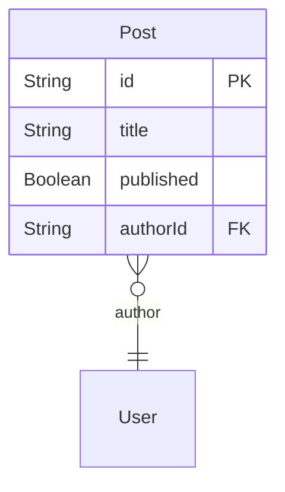
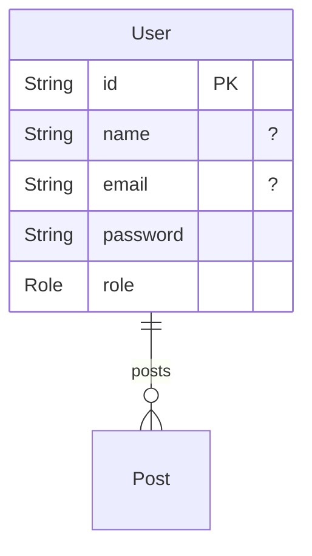

# Technical Design Document

This application is designed to manage a simple blogging platform where users can create, read, update, and delete posts. It includes user authentication and authorization features to control access to posts based on user roles and ownership.

## Functionality

The app allows users to:
- Register and log in
- Create, edit, and delete their own posts
- View all published posts or posts they own
- Admins can view all posts regardless of publication status

## Models:

- [Post](#Post)
- [User](#User)

### Post

- All operations are allowed if the authenticated user is the author of the post.
- Read access is granted if the post is published or if the user is authenticated.
- Admins have read access to all posts.
### User

- Anyone can create a new user account.
- Users can read their own profile.
- Only the user themselves can update or delete their own profile.
