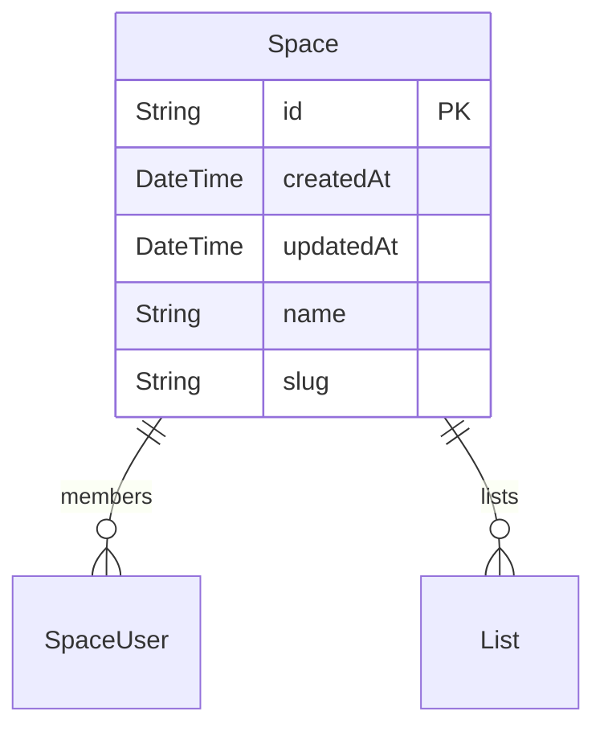
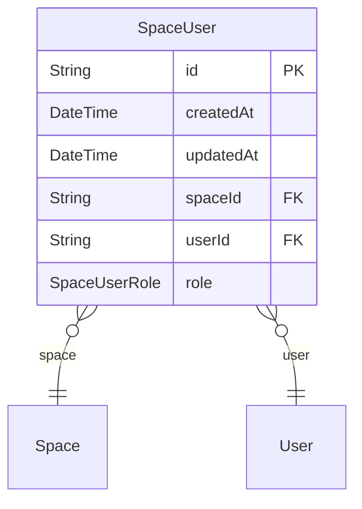
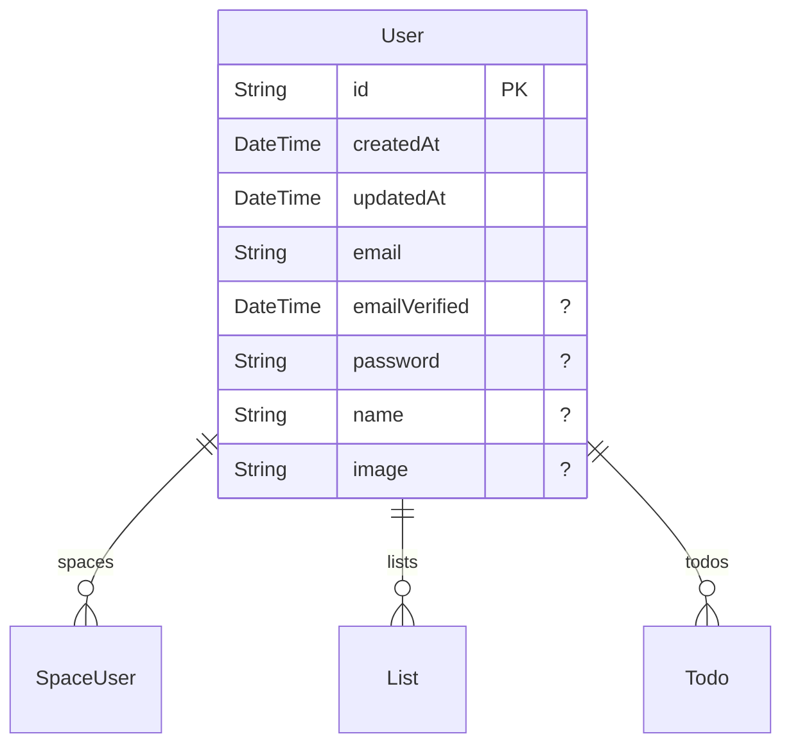
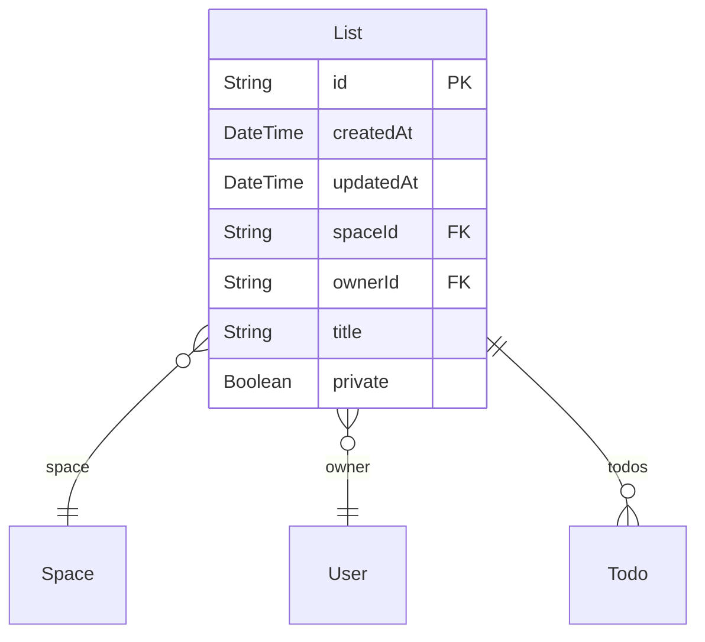
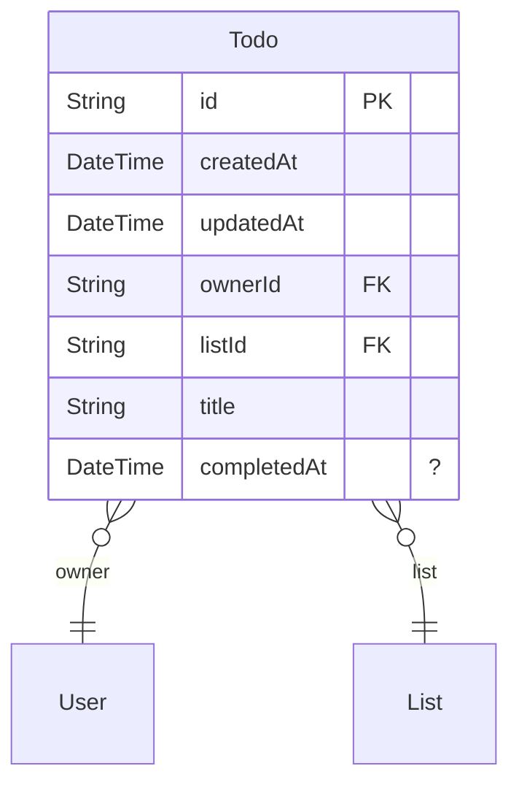
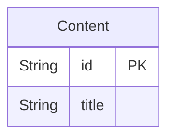

# Technical Design Document

## Overview

This ZModel defines the schema for a collaborative Todo application. It enables users to manage tasks within shared spaces, supporting features like user authentication, role-based access control, and private lists.

## Functionality

- User registration and authentication
- Creation and management of collaborative spaces
- Role-based access control for users within spaces (User, Admin)
- Creation, reading, updating, and deletion of Todo lists
- Setting Todo lists as private to restrict access
- Creation, reading, updating, and deletion of individual Todo items within lists
- Association of users, spaces, lists, and todos through defined relationships

## Enums

### SpaceUserRole
Defines the possible roles a user can have within a collaborative space: 'USER' for standard members and 'ADMIN' for administrators.
- USER
- ADMIN

## Models

- [Space](#space)
- [SpaceUser](#spaceuser)
- [User](#user)
- [List](#list)
- [Todo](#todo)
- [Content](#content)

### Space
Represents a collaborative environment where users can organize and manage lists and todos.

- All operations are denied if the user is not authenticated.
- Any user can create a new space.
- Any user who is a member of a space can read its details.
- Only administrators of a space can update or delete that space.
### SpaceUser
Represents a user's membership in a specific space, defining their role (USER or ADMIN) within that space.

- All operations are denied if the user is not authenticated.
- Only administrators of a space can create, update, or delete membership entries within that space.
- A user can read `SpaceUser` entries for spaces they are a member of.
### User
Represents an individual user of the application, including their profile and authentication credentials.

- Anyone, including unauthenticated users, can create a new user account.
- Users can read details of other users if they share at least one common space.
- A user has full access (create, read, update, delete) to their own user record.
### List
Represents a Todo list, which belongs to a specific space and has an owner. Lists can also be marked as private.

- All operations are denied if the user is not authenticated.
- Read access is granted to the owner of the list, or to any member of the parent space if the list is not private.
- A list can only be created if the current authenticated user is set as the owner and is also a member of the associated space.
- Updates are allowed only if the current authenticated user is the owner of the list, is a member of the associated space, and the 'owner' field is not being changed during the update.
- Only the owner of a list can delete it.
### Todo
Represents a single task item within a Todo list.

- All operations are denied if the user is not authenticated.
- The owner of the parent list has full access (create, read, update, delete) to the todo.
- Any member of the parent list's space also has full access (create, read, update, delete) to the todo, provided the parent list is not private.
- Updates are not allowed to change the owner of the todo.
### Content
A simple model with an ID and a title, likely for generic content storage.

- No explicit access control policies are defined for this model within the schema.

## Security Considerations

- User authentication is mandatory for most data operations to ensure only logged-in users can interact with the system, enforced by `@@deny('all', auth() == null)` rules.
- Access to spaces and their contents is governed by a robust role-based access control system (`SpaceUserRole`), distinguishing between regular users and administrators.
- Sensitive user data, such as passwords, are omitted from queries by default through the `@omit` attribute on the `password` field in the `User` model.
- Data integrity and validation are enforced through ZModel attributes like `@length`, `@regex`, `@email`, `@password`, and `@url`, preventing malformed data entry.
- Cascading deletes (`onDelete: Cascade`) are used for relationships, meaning the deletion of a parent record (e.g., a Space) will automatically delete all related child records (e.g., SpaceUsers, Lists, Todos), which must be handled carefully to prevent unintended data loss.
- Specific rules for creating, updating, and deleting ensure data consistency, such as preventing an owner change for `List` and `Todo` records during updates, and ensuring `List` creation links to the authenticated user and a valid space membership.
- Private lists restrict access to non-owners, even for space members, adding an additional layer of data segregation.
